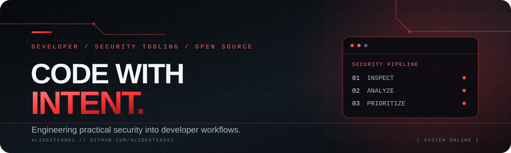
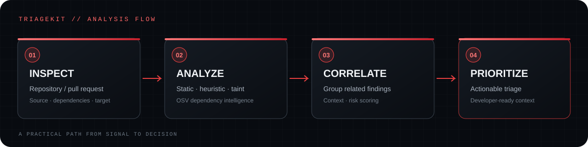

<!--
  Profile README for: https://github.com/alidexter001
  Place this file in the root of the public repository named exactly: alidexter001
  Keep the assets/ folder alongside this README.md.
-->

  

  

    
    
    
  

  
<strong>Developer · Security tooling · Open source</strong>

  
Engineering practical security into developer workflows.

  

    <a href="https://github.com/alidexter001?tab=repositories">Explore repositories</a>
    ·
    <a href="https://github.com/alidexter001">GitHub profile</a>
  

---

## `whoami` — About me

I'm a developer interested in building useful software, security-focused tools, and automation that makes engineering workflows more reliable. I enjoy working across application development and practical security analysis, with a focus on turning complex findings into clear, actionable results.

- **Building:** TriageKit, an open-source security platform for more actionable security analysis.
- **Interested in:** Application security, developer experience, automation, and open-source software.
- **Approach:** Practical analysis, explainable findings, and tools that fit into real development workflows.

## `current_operation` — TriageKit

  

**TriageKit** brings several layers of security analysis together so developers can move from raw findings to useful triage decisions.

| Capability | What it contributes |
|---|---|
| Multi-stage static and heuristic analysis | Surfaces potential security issues through complementary analysis passes |
| Language-aware taint analysis | Tracks potentially unsafe data flows |
| OSV dependency intelligence | Adds open-source dependency vulnerability context |
| Risk scoring and finding correlation | Helps prioritize and group related findings |
| AI-assisted security reasoning | Adds context to help interpret findings |
| GitHub PR triage and repository scanning | Brings analysis closer to normal development workflows |
| Authorized web assessments | Extends assessment to explicitly authorized web targets |

> **Project link:** [Browse my GitHub repositories](https://github.com/alidexter001?tab=repositories) and look for **TriageKit**. Replace this link with the direct TriageKit repository URL once its canonical location is confirmed.

## `toolbox` — Technologies & areas of work

These are technologies and domains reflected in my development work and current project context—not a proficiency ranking.

  

  
  
  
  
  

## `telemetry` — GitHub analytics

  
  

  

## `activity.log` — Contribution graph

  

## `connect` — Find me

- **GitHub:** [@alidexter001](https://github.com/alidexter001)
- **Projects:** [Repositories](https://github.com/alidexter001?tab=repositories)

I'm interested in thoughtful conversations around application security, developer tooling, and open-source projects.

---

  
  <code>ACCESS GRANTED</code> · Built with curiosity. Secured with intent.

